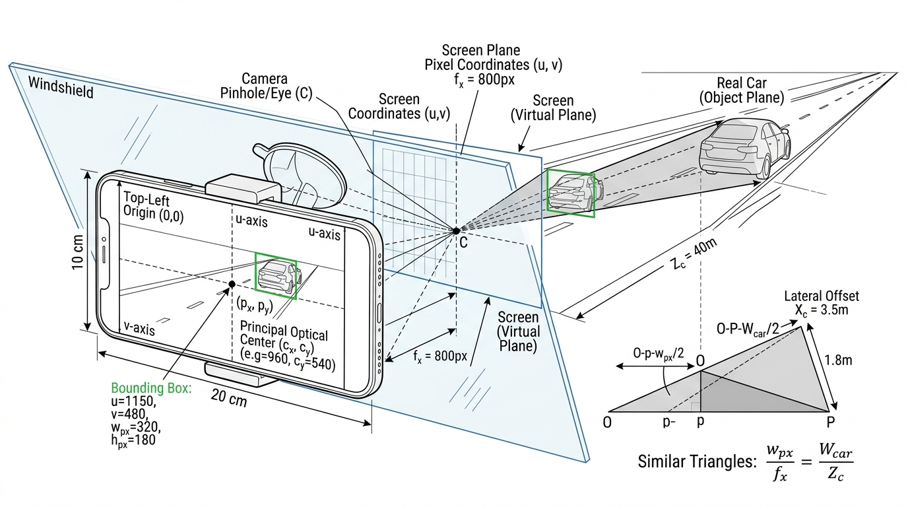
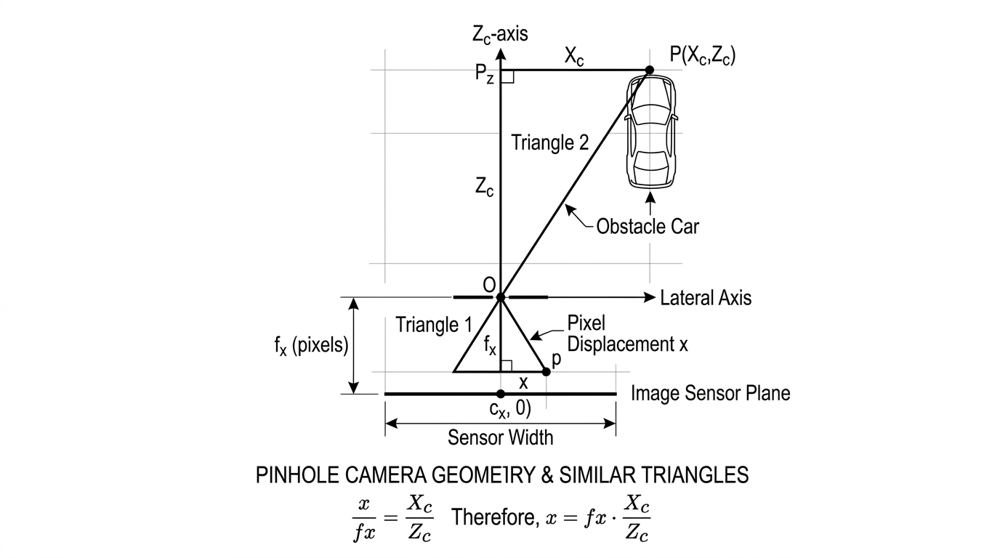
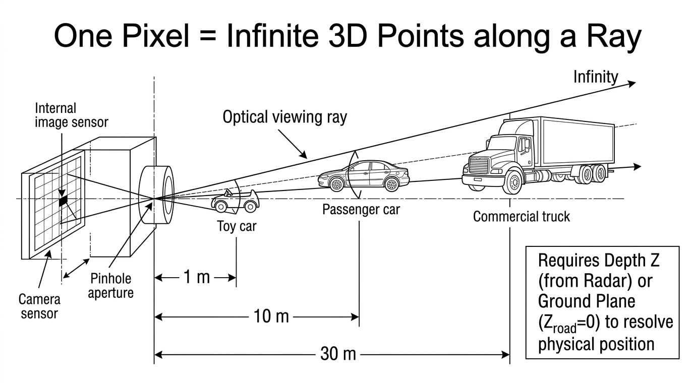
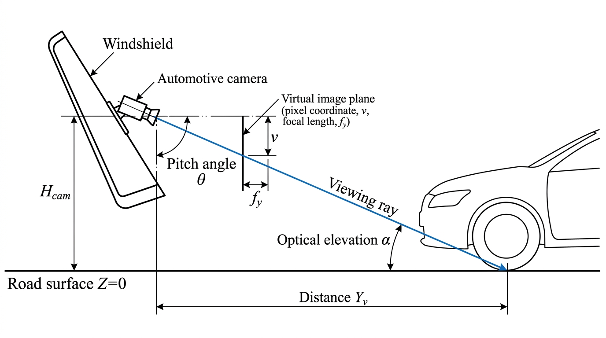

# Camera Intrinsics Explained: Physical Meaning of $f_x$, $f_y$, and the Projection Pipeline

> **Document Location:** `intel/Vision/Camera_Intrinsics_fx_fy_and_Projection_Explained.md`  
> **Target Audience:** Automotive Engineers & Perception Developers  
> **Prerequisites:** High-school similar triangles and basic 3D coordinate geometry  

---

## 1. The Intuition: What Are $f_x$ and $f_y$ Really?

When automotive engineers first encounter camera intrinsic calibration matrices, they often experience the same confusion that mechanical engineers feel when looking at thermal diffusivity ($\alpha = \frac{k}{\rho c_p}$, with units $\text{m}^2/\text{s}$):
> *"Why are focal lengths $f_x$ and $f_y$ measured in **pixels** instead of **millimeters**? How can a physical piece of glass have a 'pixel' focal length?"*

### The Physical Reality
A camera lens has a real, physical focal length in millimeters (for example, $F = 3.58\text{ mm}$ on the Samsung Galaxy M30). This is the physical distance between the center of the lens and the silicon image sensor chip inside your phone.

```
       Physical World                     Camera Hardware (Inside Phone)
─────────────────────────────        ───────────────────────────────────────
                                            Lens
                                           Center
                                             │
      Object in 3D Space                     │◄────── F (3.58 mm) ──────►│
        (Meters away)                        │                           │
              ●                              │                           │
               \                             │                           │
                \                            │                       ┌───┴───┐
                 \                           │                       │Silicon│
                  \                          │                       │Sensor │
                   ──────────────────────────●───────────────────────┤ Chip  │
                                         (Pinhole)                   │(1080p)│
                                                                     └───┬───┘
                                                                         │
                                                                   Pixel pitch:
                                                                   e.g. 2.41 µm/px
```

However, the image processing algorithm (YOLO, OpenCV, Foxglove) does **not** count millimeters on the silicon chip—it counts **discrete pixels** ($1920 \times 1080$)!

* If your sensor chip is $4.64\text{ mm}$ wide and packed with $1920$ horizontal pixels, each pixel has a physical width of:
  $$\text{Pixel Size} = \frac{4.64\text{ mm}}{1920\text{ px}} \approx 0.00241\text{ mm/pixel} = 2.41\ \mu\text{m}$$
* If we express the physical focal length $F = 3.58\text{ mm}$ in units of "pixels":
  $$f_x = \frac{F\ [\text{mm}]}{\text{Pixel Width}\ [\text{mm/px}]} = \frac{3.58\text{ mm}}{0.00241\text{ mm/px}} \approx \mathbf{1486.5\text{ pixels}}$$

> [!TIP]
> **The Key Takeaway:**  
> **$f_x$ is simply the physical focal distance from the lens to the sensor chip, measured using the sensor's own pixel grid as the ruler.**  
> It acts as the **gear ratio** that converts an angular ray of light in the physical 3D world into a pixel distance on screen.

---

## 2. Looking Through the Phone Screen: The 3 Coordinate Systems & Triangles

The most intuitive way to understand how $f_x$ works in RoadSense is to look **from behind the smartphone screen, through the viewfinder, out into the real road**:



As shown in the technical diagram above, three distinct planes/coordinate spaces are nested together by perspective projection:

### 1. Screen Coordinates (The Viewfinder Display)
* **Origin $(0, 0)$:** At the **top-left corner** of the smartphone glass.
* **Axes:** $+u$ points right across the screen width ($0 \dots 1920\text{ px}$), $+v$ points downward ($0 \dots 1080\text{ px}$).
* **What lives here:** YOLO 2D bounding boxes $(u, v, w_{\text{px}}, h_{\text{px}})$, touch interactions, and UI overlays.

### 2. Sensor / Virtual Plane Coordinates (The Focal Plane)
* **Origin $(c_x, c_y)$:** The **Principal Optical Center** right in the middle of the lens ($960, 540$).
* **Focal Distance ($f_x, f_y$):** The distance between the camera optical pinhole $C$ and this virtual screen plane.
* **Displacement $(x, y)$:** How many pixels a feature sits to the right or below the lens center:
  $$x = u - c_x, \quad y = v - c_y$$

### 3. Real-World Coordinates (3D Automotive Space)
* **Origin:** The camera lens / vehicle origin.
* **Axes:** Forward depth $+Z_c$ (meters), lateral offset $+X_c$ (meters, right), elevation $+Y_c$ (meters, down).
* **What lives here:** The real car on the road with physical metric width $W_{\text{car}}$ (e.g. $1.8\text{ m}$), length, and depth $Z_c$.

---

## 3. How $f_x$ Determines Bounding Box Size and Vehicle Range

Looking at the similar triangles formed between the virtual screen plane and the real car:

$$\frac{\text{Bounding Box Pixel Width } (w_{\text{px}})}{\text{Focal Length } (f_x)} = \frac{\text{Physical Car Width } (W_{\text{car}})}{\text{Forward Depth } (Z_c)}$$

This single ratio unlocks **both size determination and range estimation**:

### A. Determining Bounding Box Size on Screen (Forward Projection):
If a lead vehicle has a known physical width of $W_{\text{car}} = 1.8\text{ meters}$ and sits at depth $Z_c$:
$$w_{\text{px}} = f_x \times \frac{W_{\text{car}}}{Z_c}$$

* At $Z_c = 10\text{ meters}$:
  $$w_{\text{px}} = 1486.5 \times \frac{1.8\text{ m}}{10\text{ m}} = \mathbf{267.6\text{ pixels wide}}$$
* At $Z_c = 20\text{ meters}$ (twice as far):
  $$w_{\text{px}} = 1486.5 \times \frac{1.8\text{ m}}{20\text{ m}} = \mathbf{133.8\text{ pixels wide}}$$
*(When distance doubles, the bounding box shrinks exactly by half!)*

---

### B. Determining Range from Bounding Box Size (The Optical Sizing Prior):
In computer vision, when radar is occluded or not yet tracking, we can solve for range directly from the 2D bounding box width $w_{\text{px}}$ using our vehicle class width prior ($W_{\text{car}} \approx 1.8\text{ m}$):

$$Z_c = f_x \times \frac{W_{\text{car}}}{w_{\text{px}}}$$

* If YOLO detects a car with bounding box width $w_{\text{px}} = 268\text{ px}$:
  $$Z_c = 1486.5 \times \frac{1.8\text{ m}}{268\text{ px}} = \mathbf{10.0\text{ meters}}$$

---

### C. Determining Lateral Position ($X_c$):
Once forward depth $Z_c$ is known (from radar or optical sizing), the lateral position across the road lane is directly calculated from horizontal pixel displacement:

$$X_c = \frac{u - c_x}{f_x} \times Z_c$$

---

## 4. Top-Down Bird's-Eye View: The Azimuth Plane

To see the exact same triangles from an engineering blueprint perspective:



Looking at the two right-angled triangles sharing the pinhole vertex:
* **Triangle 1 (Inside the camera):** Base $x$ (sensor displacement), Height $f_x$ (focal length in pixels).
* **Triangle 2 (In the real world):** Base $X_c$ (car lateral offset in meters), Height $Z_c$ (car depth in meters).

$$\frac{x}{f_x} = \frac{X_c}{Z_c} \implies x = f_x \cdot \frac{X_c}{Z_c}$$

---

## 5. Fundamental Question: Can $f_x$ Alone Give Us 2D Real-World Coordinates?

> **Question:** *"If we have this value ($f_x$), can we directly correlate the pixel on the screen to a coordinate in 2D space in the real world?"*

### The Answer: **No, not by itself! A single pixel defines an OPTICAL RAY (a direction), NOT a unique point!**

Look closely at the formula:
$$\frac{u - c_x}{f_x} = \frac{X_c}{Z_c}$$

Notice that the right side is a **ratio**: $\frac{X_c}{Z_c}$. It gives us the **slope or angle** of the line of sight, but leaves **1 equation with 2 unknowns** ($X_c$ and $Z_c$).



### Why a Single Pixel is Ambiguous:
Consider three completely different objects sitting on the exact same line of sight ($\frac{X_c}{Z_c} = 0.10$):
1. A small **toy car** at $Z_c = 1.0\text{ m}$ depth and $X_c = 0.1\text{ m}$ lateral offset.
2. A real **passenger car** at $Z_c = 10.0\text{ m}$ depth and $X_c = 1.0\text{ m}$ lateral offset.
3. A large **commercial truck** at $Z_c = 30.0\text{ m}$ depth and $X_c = 3.0\text{ m}$ lateral offset.

**All three objects project to the exact same pixel $u = 1109\text{ px}$ on your phone screen!**

A 2D camera image flattens the 3D world, losing the depth dimension. Therefore, to resolve a real-world coordinate $(X, Y, Z)$, you **must have one extra piece of physical information**:

1. **Option 1 (Sensor Fusion): Direct Depth Measurement ($Z$) from Radar / LiDAR**  
   * The mmWave radar gives us direct range ($Z_c = 10.0\text{ m}$).  
   * Once $Z_c$ is known, $X_c$ is instantly resolved:
     $$X_c = \frac{u - c_x}{f_x} \times Z_c$$

2. **Option 2 (Computer Vision): Physical Boundary Constraint (The Flat Road $Z_{\text{road}} = 0$)**  
   * We know vehicles have tires that touch the road asphalt ($Z_{\text{road}} = 0$).  
   * By casting the viewing ray through the tire contact patch $v_{\text{bottom}}$ down to the road plane, we can mathematically solve where the ray strikes the ground!

---

## 6. Side View: Modality 1 Ground-Plane Ray Intersection

When we do not have a radar track for a detected visual obstacle, we use the **Flat Road Surface Constraint**:



### Step-by-Step Geometry (Side View):
1. **Camera Mounting Height ($H_{\text{cam}}$):** Phone mounted on windshield at $1.45\text{ m}$ above the asphalt.
2. **Downward Pitch ($\theta$):** Camera tilted down by $+7.0^\circ$ toward the road ahead.
3. **Optical Elevation Angle ($\alpha$):** Calculated from the bottom edge of the YOLO bounding box $v_{\text{bottom}}$ using $f_y$:
   $$\alpha = \arctan\left(\frac{v_{\text{bottom}} - c_y}{f_y}\right)$$
4. **Total Angle of Depression ($\beta$):**
   $$\beta = \theta + \alpha$$
5. **Real-World Longitudinal Distance ($Y_v$):** By basic trigonometry on the right-angled triangle formed by camera height and the road:
   $$\tan(\beta) = \frac{H_{\text{cam}}}{Y_v} \implies Y_v = \frac{H_{\text{cam}}}{\tan(\theta + \alpha)}$$
6. **Real-World Lateral Distance ($X_v$):** Once $Y_v$ is solved, lateral distance is resolved directly using $f_x$:
   $$X_v = \frac{u - c_x}{f_x} \times Y_v + \Delta X_{\text{camera}}$$

---

## 7. The Matrix Form: The Camera Intrinsic Matrix ($K$)

In computer vision (OpenCV, ROS, Foxglove Studio), the equations:
$$u = f_x \frac{X_c}{Z_c} + c_x, \quad v = f_y \frac{Y_c}{Z_c} + c_y$$
are packaged into a single $3 \times 3$ matrix called $K$:

$$K = \begin{bmatrix} f_x & 0 & c_x \\ 0 & f_y & c_y \\ 0 & 0 & 1 \end{bmatrix}$$

Multiplying a 3D camera point $\mathbf{P}_c = [X_c, Y_c, Z_c]^T$:

$$\begin{bmatrix} s \cdot u \\ s \cdot v \\ s \end{bmatrix} = K \cdot \mathbf{P}_c = \begin{bmatrix} f_x & 0 & c_x \\ 0 & f_y & c_y \\ 0 & 0 & 1 \end{bmatrix} \begin{bmatrix} X_c \\ Y_c \\ Z_c \end{bmatrix} = \begin{bmatrix} f_x X_c + c_x Z_c \\ f_y Y_c + c_y Z_c \\ Z_c \end{bmatrix}$$

Dividing by the projective scale factor $s = Z_c$ recovers $(u, v)$!

---

## 8. Concrete Numerical Walkthrough

### Given Parameters (Galaxy M30 at 1080p):
* $f_x = 1486.5\text{ px}, \quad f_y = 1486.5\text{ px}, \quad c_x = 960.0\text{ px}, \quad c_y = 540.0\text{ px}$
* Camera mount height: $H_{\text{cam}} = 1.45\text{ m}$, Downward pitch: $\theta = 7.0^\circ$

### Scenario A: Projecting a Radar Point to Screen $(u, v)$
Radar detects an obstacle at $Z_c = 10.0\text{ m}$ ahead, $X_c = +1.0\text{ m}$ to the right, and $Y_c = +0.5\text{ m}$ below the camera lens:
1. $x = 1486.5 \times \frac{1.0}{10.0} = +148.65\text{ px}$
2. $y = 1486.5 \times \frac{0.5}{10.0} = +74.33\text{ px}$
3. $u = 960 + 148.65 = \mathbf{1108.65\text{ px}}$
4. $v = 540 + 74.33 = \mathbf{614.33\text{ px}}$
* Target appears on phone screen at pixel **$(1109, 614)$**.

### Scenario B: Reverse Raycasting from a YOLO Bounding Box $(u, v) \to$ Real 3D World
YOLO detects a car with bottom tire contact pixel at $(u = 1109, v = 614)$:
1. Optical elevation: $\alpha = \arctan\left(\frac{614 - 540}{1486.5}\right) = \arctan(0.0498) \approx 2.85^\circ$
2. Total depression angle: $\beta = 7.0^\circ + 2.85^\circ = 9.85^\circ$
3. Longitudinal Distance: $Y_v = \frac{1.45\text{ m}}{\tan(9.85^\circ)} = \frac{1.45}{0.1736} = \mathbf{8.35\text{ meters}}$
4. Lateral Offset: $X_v = \frac{1109 - 960}{1486.5} \times 8.35\text{ m} = \mathbf{+0.84\text{ meters}}$

---

## 9. Summary Cheat-Sheet

| Term | What It Is | First-Principles Meaning |
|---|---|---|
| **$f_x, f_y$** | Focal length in pixels | Distance from lens to sensor chip, measured in sensor pixels. The angular gear ratio. |
| **$c_x, c_y$** | Principal point | Center pixel of the sensor where the lens optical axis punches through ($W/2, H/2$). |
| **Pixel $(u, v)$** | Screen coordinate | Defines an **optical ray** (an angular direction), NOT a unique distance. |
| **$w_{\text{px}}$** | Bounding box pixel width | Related to physical width and range by $\frac{w_{\text{px}}}{f_x} = \frac{W_{\text{car}}}{Z_c}$. |
| **Depth $Z$** | Forward distance | The missing piece required to convert a 2D ray into a 3D metric coordinate $(X, Y, Z)$. Provided by Radar or Ground Plane intersection. |


