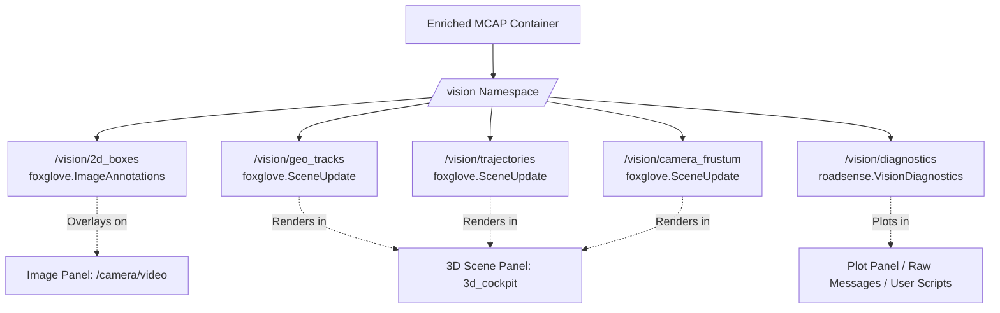
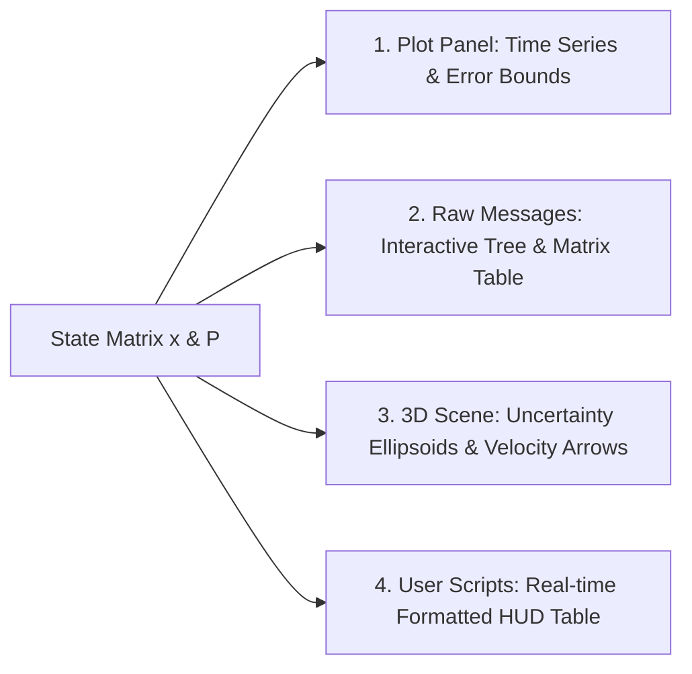

# Vision Pipeline Debugging, Observability & State Matrix Specification

## 1. Overview & Architectural Purpose

The RoadSense multimodal MCAP container provides unified recording across radar, camera, IMU, CAN, and GNSS. While raw 3D bounding boxes (`/vision/geo_tracks`) visualize the spatial position of detected obstacles, debugging complex edge cases—such as heading rotation during ego turning, pothole/pitch transients, and track state divergence—requires **white-box observability**.

This document defines the complete Foxglove MCAP vision debugging architecture:
1. **2D Image Annotations (`/vision/2d_boxes`)**: Overlaying YOLO bounding boxes, track labels, and ground contact points directly onto `/camera/video`.
2. **3D Scene Augmentation (`/vision/geo_tracks`, `/vision/trajectories`, `/vision/camera_frustum`)**: Adding 3D velocity vectors, contact footprints, multi-second trajectory breadcrumbs, and camera optical ground bounds.
3. **Structured Telemetry Diagnostics (`/vision/diagnostics`)**: Publishing per-frame kinematics, host vehicle turning compensation states, and the complete **State Matrix** $\mathbf{x}$ and **Covariance Matrix** $\mathbf{P}$.
4. **Foxglove Studio Visualization Methodologies**: Plot panel time-series syntax, raw message matrix inspection, 3D covariance ellipses, and live HUD user scripts.
5. **Reusability for Radar Tracking**: How this exact state matrix schema maps directly to radar EKF tracking (`/radar/diagnostics`).

---

## 2. Vision Sub-Topic Hierarchy & Schema Specifications

All vision topics reside under the `/vision/` namespace to keep Foxglove Studio's channel selector clean and categorized:



| Sub-Topic | Schema Name | Message Encoding | Target Panel in Foxglove | Description |
| :--- | :--- | :--- | :--- | :--- |
| **`/vision/2d_boxes`** | `foxglove.ImageAnnotations` | Protobuf | Camera View (`/camera/video`) | 2D YOLO rectangles, class/confidence labels, and bottom-center contact points. |
| **`/vision/geo_tracks`** | `foxglove.SceneUpdate` | Protobuf | 3D Cockpit (`base_link`) | 3D oriented cuboids, billboard labels, velocity arrows, and ground contact footprints. |
| **`/vision/trajectories`** | `foxglove.SceneUpdate` | Protobuf | 3D Cockpit (`base_link`) | Trajectory history breadcrumb line strips (past 3 seconds per track). |
| **`/vision/camera_frustum`** | `foxglove.SceneUpdate` | Protobuf | 3D Cockpit (`base_link`) | Static/periodic wireframe trapezoid of the camera's ground projection limits on $Z = 0$. |
| **`/vision/diagnostics`** | `roadsense.VisionDiagnostics` | JSON Schema | Plot Panel, Raw Messages, Table | Per-frame kinematics, ego turning state, lead obstacle summary, and per-track State Matrices. |

---

## 3. Deep Dive: `/vision/2d_boxes` (2D Video Overlay)

### 3.1 Why 2D Overlay is Essential for Debugging
When inspecting 3D bounding boxes in Foxglove's 3D panel, an engineer cannot easily determine whether an orientation error originated from:
1. **2D Detector Misalignment**: Did YOLO clip the front bumper or misidentify a shadow?
2. **Ground Contact Error**: Did the bottom center point $(u_{\text{bottom}}, v_{\text{bottom}})$ land on the road surface or on the vehicle chassis?
3. **3D Projection / Turning Model Distortion**: Was the ground ray projection or CAN ego turning compensation incorrect?

Overlaying `/vision/2d_boxes` onto `/camera/video` resolves this immediately.

### 3.2 Schema Structure (`foxglove.ImageAnnotations`)
* **`points` (`PointsAnnotation`, `type=LINE_LOOP`)**: 4 pixel coordinates $[(x_1, y_1), (x_2, y_1), (x_2, y_2), (x_1, y_2)]$ forming the closed rectangular boundary.
  * Outline colors by vehicle category:
    * Cars/Trucks/Buses: Electric Magenta (`rgba: 0.85, 0.10, 0.95, 0.85`)
    * Motorcycles/Bicycles: Vivid Amber (`rgba: 1.0, 0.75, 0.10, 0.85`)
    * Pedestrians: Bright Cyan (`rgba: 0.10, 0.85, 1.0, 0.85`)
* **`texts` (`TextAnnotation`)**: Rendered directly above the top edge at $(x_1, y_1 - 4)$:
  * `ID #{track_id} | {CLASS} | {conf:.2f} | {range_m:.1f}m`
* **`circles` (`CircleAnnotation`)**: An 8-pixel diameter dot rendered at the exact ground contact pixel $(u_{\text{bottom}}, v_{\text{bottom}}) = \left(\frac{x_1 + x_2}{2}, y_2\right)$:
  * Fill: Neon Green (`rgba: 0.10, 1.0, 0.20, 0.95`) with dark border.
  * **Visual Check**: If the green dot is not sitting on the road plane where the tires meet the asphalt, the ground-plane projection $(Z=0)$ will calculate an incorrect longitudinal distance $X_{\text{fwd}}$.

---

## 4. Deep Dive: `/vision/diagnostics` & The State Matrix

The `/vision/diagnostics` message utilizes Foxglove's native JSON Schema. It is structured into **three complementary tiers** designed for both instant 1-click plotting and deep matrix inspection.

### 4.1 Tier 1: Host Vehicle Dynamics & Turning Model Context
Contains the frame-level dynamics and compensation state:

```json
{
  "frame_index": 1420,
  "timestamp_utc_ns": 1792750280123456789,
  "track_count": 4,
  "moving_track_count": 2,
  "ego_speed_mps": 11.25,
  "ego_speed_kmh": 40.5,
  "ego_yaw_rate_can_radps": -0.048,
  "ego_yaw_rate_smoothed_degps": -2.75,
  "ego_turning_model_active": true,
  "ego_deadband_scale": 0.82
}
```

* `ego_yaw_rate_smoothed_degps`: The filtered zero-phase yaw rate. In Foxglove's Plot panel, you can plot this directly alongside `/vehicle/telemetry.yaw_rate_radps` to verify noise rejection.
* `ego_turning_model_active`: Boolean flag indicating whether the turning compensation filter is active.
* `ego_deadband_scale`: Smooth Hermite scaling factor $[0.0, 1.0]$ showing how much attenuation is being applied near the sensor noise floor ($0.57^\circ/\text{s} \to 1.43^\circ/\text{s}$).

---

### 4.2 Tier 2: Lead / Primary Obstacle Summary (1-Click Plotting)
In Foxglove Studio, selecting nested items inside an array of 10 tracks requires typing slice queries. To make plotting instant, Tier 2 extracts the primary lead obstacle (the closest obstacle in the path) into flat, top-level fields:

```json
"lead_obstacle": {
  "track_id": 4991,
  "class_name": "car",
  "range_m": 28.05,
  "x_fwd_m": 28.01,
  "y_left_m": 1.45,
  "speed_kmh": -38.2,
  "vx_mps": -10.61,
  "vy_mps": 0.15,
  "yaw_deg": 178.2,
  "ttc_sec": 1.95
}
```

You can plot `/vision/diagnostics.lead_obstacle.range_m` or `/vision/diagnostics.lead_obstacle.speed_kmh` with a single click in Foxglove!

---

### 4.3 Tier 3: Per-Track Array & Complete State Matrix (`tracks[...]`)
Every active track provides a complete mathematical breakdown of its filter state.

#### 1. Mathematical Formulation
In vehicle tracking, the state of obstacle $i$ at time $t$ is represented by the 6-state vector $\mathbf{x}$:

$$\mathbf{x} = \begin{bmatrix} x \\ y \\ v_x \\ v_y \\ \psi \\ \omega \end{bmatrix} = \begin{bmatrix} \text{Longitudinal position (+Forward in base\_link, m)} \\ \text{Lateral position (+Left in base\_link, m)} \\ \text{Forward velocity in world frame (m/s)} \\ \text{Lateral velocity in world frame (m/s)} \\ \text{Heading angle in vehicle frame (rad or deg)} \\ \text{Angular yaw rate of target (rad/s or deg/s)} \end{bmatrix}$$

The state uncertainty is represented by the symmetric $6 \times 6$ Covariance Matrix $\mathbf{P}$:

$$\mathbf{P} = \begin{bmatrix} 
\sigma_x^2 & \sigma_{xy} & \sigma_{x,vx} & \sigma_{x,vy} & \sigma_{x,\psi} & 0 \\
\sigma_{yx} & \sigma_y^2 & \sigma_{y,vx} & \sigma_{y,vy} & \sigma_{y,\psi} & 0 \\
\sigma_{vx,x} & \sigma_{vx,y} & \sigma_{vx}^2 & \sigma_{vx,vy} & 0 & 0 \\
\sigma_{vy,x} & \sigma_{vy,y} & \sigma_{vy,vx} & \sigma_{vy}^2 & 0 & 0 \\
\sigma_{\psi,x} & \sigma_{\psi,y} & 0 & 0 & \sigma_\psi^2 & \sigma_{\psi,\omega} \\
0 & 0 & 0 & 0 & \sigma_{\omega,\psi} & \sigma_\omega^2
\end{bmatrix}$$

#### 2. JSON Diagnostics Payload Format

```json
{
  "track_id": 4991,
  "class_name": "car",
  "confidence": 0.88,
  "range_m": 28.05,
  "is_moving": true,
  "speed_kmh": 38.2,
  "basin": "oncoming",
  "heading_jitter_deg": 1.4,
  "state_matrix": {
    "state_vector": {
      "x_m": 28.01,
      "y_left_m": 1.45,
      "vx_mps": -10.61,
      "vy_mps": 0.15,
      "yaw_deg": 178.2,
      "yaw_rate_degps": -0.32
    },
    "covariance_diag": {
      "sigma_x_m": 0.42,
      "sigma_y_m": 0.18,
      "sigma_vx_mps": 0.35,
      "sigma_vy_mps": 0.15,
      "sigma_yaw_deg": 2.15,
      "sigma_yaw_rate_degps": 0.85
    },
    "covariance_matrix": [
      [0.1764, 0.0080, 0.0420, 0.0000, 0.0000, 0.0000],
      [0.0080, 0.0324, 0.0000, 0.0150, 0.0000, 0.0000],
      [0.0420, 0.0000, 0.1225, 0.0050, 0.0000, 0.0000],
      [0.0000, 0.0150, 0.0050, 0.0225, 0.0000, 0.0000],
      [0.0000, 0.0000, 0.0000, 0.0000, 4.6225, 0.0200],
      [0.0000, 0.0000, 0.0000, 0.0000, 0.0200, 0.7225]
    ],
    "residuals": {
      "dx_m": -0.04,
      "dy_m": 0.02,
      "range_residual_m": 0.045
    }
  }
}
```

---

## 5. Visualizing the State Matrix in Foxglove Studio

There are **4 distinct ways** to visualize the State Matrix in Foxglove Studio:



### Method 1: Time-Series Curves in the Plot Panel
In Foxglove Studio's Plot panel, you can type explicit field paths or JSONPath slice filters to plot state variables over time:

| What to Diagnose | Plot Panel Path | Expected Behavior |
| :--- | :--- | :--- |
| **Lead Obstacle Range** | `/vision/diagnostics.lead_obstacle.range_m` | Smooth monotonic ramp during approach. |
| **Lead Obstacle Speed** | `/vision/diagnostics.lead_obstacle.speed_kmh` | Stable plateau matching radar Doppler speed. |
| **Specific Track Heading** | `/vision/diagnostics.tracks[:]{track_id==4991}.state_matrix.state_vector.yaw_deg` | Locked at $\approx 178^\circ\text{--}180^\circ$ for oncoming vehicles. |
| **Heading Jitter / Error** | `/vision/diagnostics.tracks[:]{track_id==4991}.heading_jitter_deg` | Should remain low ($< 3.0^\circ$). Spikes reveal unhandled pitch bumps. |
| **Filter Uncertainty ($1\sigma$)** | `/vision/diagnostics.tracks[:]{track_id==4991}.state_matrix.covariance_diag.sigma_yaw_deg` | Decreases over consecutive frames as filter gains confidence. |
| **Innovation Residuals** | `/vision/diagnostics.tracks[:]{track_id==4991}.state_matrix.residuals.dx_m` | Zero-mean Gaussian noise around $0.0\text{ m}$. |

---

### Method 2: Live Matrix Inspector in the Raw Messages / Table Panel
* Open the **Raw Messages** or **Table** panel in Foxglove Studio.
* Select the `/vision/diagnostics` topic.
* While scrubbing the video timeline frame-by-frame, Foxglove renders the full interactive tree:
  * You can expand `state_matrix -> covariance_matrix` to view the full numerical $6 \times 6$ table.
  * You can check `covariance_diag` to see if positional uncertainty $\sigma_x$ expands when a target moves further away.

---

### Method 3: 3D Uncertainty Ellipsoid in 3D Scene Panel
In `/vision/geo_tracks`, the covariance diagonal values $(\sigma_x, \sigma_y)$ are rendered as a translucent 2D ground ellipse:
* Centered at $(x_{\text{fwd}}, y_{\text{left}}, 0.05)$ with radii $2\sigma_x$ and $2\sigma_y$.
* When tracking is confident, the ellipse is a tight circle under the wheels.
* If camera pitch changes or distance exceeds $40\text{ m}$, the ellipse stretches along the longitudinal axis, immediately communicating depth uncertainty to the user.

---

### Method 4: Live Formatted HUD via Foxglove User Script
Foxglove Studio contains a built-in **User Scripts** panel. You can paste the following 15-line script to generate an instant real-time HUD table of the State Matrix:

```typescript
import { Input, Output } from "./types";

type VisionDiag = {
  ego_speed_kmh: number;
  ego_yaw_rate_smoothed_degps: number;
  tracks: Array<{
    track_id: number;
    class_name: string;
    speed_kmh: number;
    basin: string;
    state_matrix: {
      state_vector: { x_m: number; y_m: number; vx_mps: number; vy_mps: number; yaw_deg: number };
      covariance_diag: { sigma_x_m: number; sigma_y_m: number; sigma_yaw_deg: number };
    };
  }>;
};

export function init() {}

export function processMessage(event: Input<"/vision/diagnostics">): Output<"table"> {
  const msg = event.message as VisionDiag;
  const rows = msg.tracks.map((t) => ({
    ID: t.track_id,
    Class: t.class_name,
    Basin: t.basin,
    "Range X (m)": t.state_matrix.state_vector.x_m.toFixed(2),
    "Lat Y (m)": t.state_matrix.state_vector.y_m.toFixed(2),
    "Speed (km/h)": t.speed_kmh.toFixed(1),
    "Yaw (deg)": t.state_matrix.state_vector.yaw_deg.toFixed(1),
    "σ_x (m)": t.state_matrix.covariance_diag.sigma_x_m.toFixed(2),
    "σ_yaw (deg)": t.state_matrix.covariance_diag.sigma_yaw_deg.toFixed(1),
  }));
  return { rows };
}
```

---

## 6. Extending the State Matrix Architecture to Radar Tracking

The schema designed here for `/vision/diagnostics` directly parallels the radar EKF tracker:

| Concept | Vision Pipeline (`/vision/diagnostics`) | Radar EKF Tracker (`/radar/diagnostics`) |
| :--- | :--- | :--- |
| **Measurement Vector $\mathbf{z}$** | 2D Contact Pixel $(u, v) \xrightarrow{\text{IPM}} (x, y)$ | Range, Azimuth, Doppler $(r, \theta, v_r)$ |
| **State Vector $\mathbf{x}$** | $[x, y, v_x, v_y, \psi, \omega]^T$ | $[x, y, v_x, v_y, a_x, a_y]^T$ |
| **Covariance Matrix $\mathbf{P}$** | $6 \times 6$ ground projection & turning covariance | $6 \times 6$ Extended Kalman Filter covariance |
| **Host Ego Motion** | CAN speed + Smoothed CAN yaw rate | CAN speed + Radar ego-motion RANSAC |
| **Diagnostics Topic** | `/vision/diagnostics` | `/radar/diagnostics` |
| **Visual Scene Topic** | `/vision/geo_tracks` (Magenta) | `/radar/tracks` (Cyan/Amber) |

By standardizing both pipelines on this State Matrix format:
1. Foxglove Studio layouts and plot configurations work symmetrically for both radar and vision.
2. In the future Sensor Fusion stage, computing the Mahalanobis distance between vision state $\mathbf{x}_{\text{vis}}$ and radar state $\mathbf{x}_{\text{rad}}$ becomes a simple closed-form calculation:
   $$d_M^2 = (\mathbf{x}_{\text{vis}} - \mathbf{x}_{\text{rad}})^T (\mathbf{P}_{\text{vis}} + \mathbf{P}_{\text{rad}})^{-1} (\mathbf{x}_{\text{vis}} - \mathbf{x}_{\text{rad}})$$

---

## 7. Dual-Pipeline MCAP Integration Guarantees

All sub-topics defined in this document are injected into MCAP containers via two paths:

1. **Full Initial MCAP Conversion ([`tools/convert_session_to_mcap.py`](file:///c:/Users/rakadu1.AHEAD/AndroidStudioProjects/RoadSense/tools/convert_session_to_mcap.py))**:
   - Automatically detects if `tools/vision/output/json/<session>_vision_tracks.json` or `<session>/vision_tracks.json` exists.
   - Registers all `/vision/*` channels during initial conversion and interleaves them with `/camera/video` and `/radar/tracks` in a single pass.
2. **Fast Post-Processing Injection ([`tools/vision/mcap/inject_vision_tracks.py`](file:///c:/Users/rakadu1.AHEAD/AndroidStudioProjects/RoadSense/tools/vision/mcap/inject_vision_tracks.py))**:
   - Takes pre-computed vision JSON tracks and merges all `/vision/*` channels into existing MCAP containers in seconds without modifying source files.
   - Strictly preserves UTC Wall Clock nanosecond alignment, ensuring 2D image annotations, 3D cuboids, and telemetry diagnostic plots stay synchronized across the entire session timeline.
